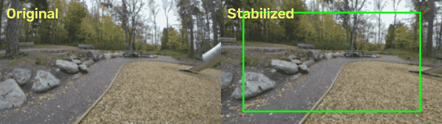
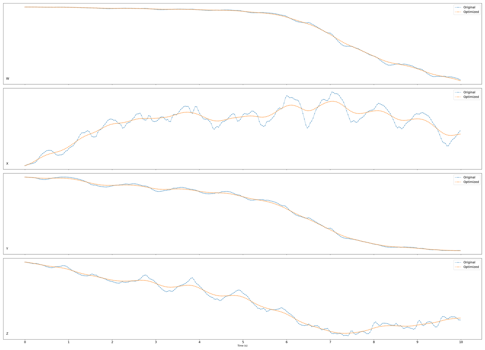
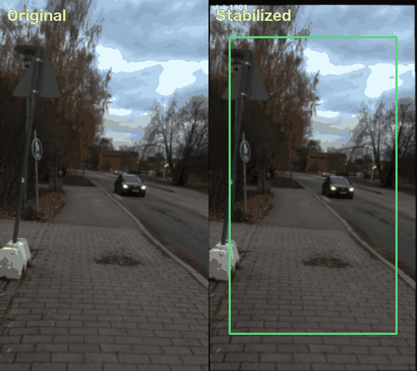
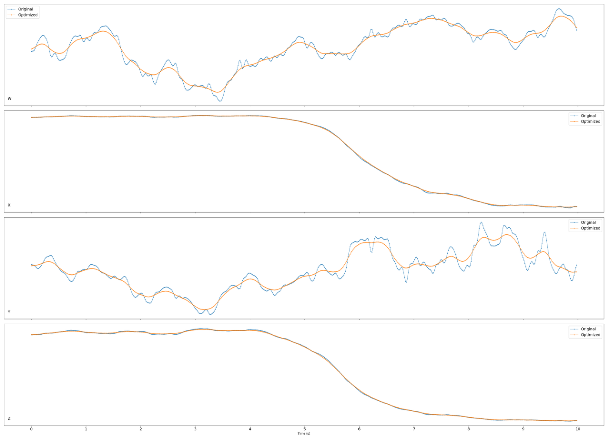
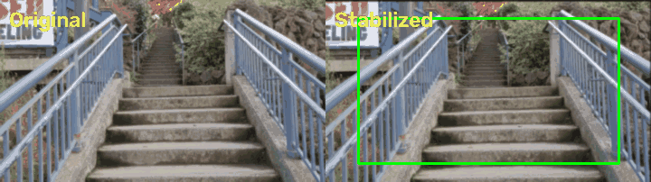
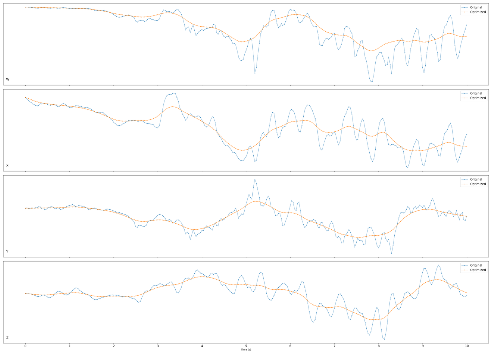

# Quartet

把 IMU 姿态优化成平滑序列，同时保证防抖后画面不越过裁剪边界。

边界是优化问题的一部分，不是平滑之后再检查：姿态和安全边距一起收敛，裁剪量提前定好。59 条序列、5806 个窗口，最坏越界 0.045 px。

求解器为 Gauss-Newton + 增广拉格朗日：内层最小化速度、加速度、加加速度、保真度四项损失，外层用 RCS 网格的 SDF 约束。推导见 `docs/`。

附 GoPro-IMU / ADVIO / DVS 三个数据集的输入生成与渲染适配器，以及对比图、并排 GIF 工具。

[English](README_EN.md)

---

## 目录结构

```
quartet/
├── src/                    C++ 实现（main / DataLoader / Optimizer / GeometryTools / FileUtils）
├── include/                对应头文件
├── data/                   默认输入输出
│   ├── quat.csv            原始姿态
│   ├── opt.csv             优化结果（运行后覆盖）
│   ├── rcs.csv             RCS 网格
│   └── conf.yaml           内参、帧尺寸、网格、裁剪
├── adapters/               数据集适配（common.py 为共享数学核心）
│   ├── gopro_imu/
│   ├── advio/
│   └── dvs/
├── utils/
│   ├── plot_quaternions.py 四元数对比图
│   └── make_compare_gif.py 左右并排 GIF
├── scripts/                批量优化、渲染
├── tests/                  Jacobian、平滑度、SDF 尺度自检
└── docs/
    ├── media/              README 用的 GIF 与对比图
    └── *.md, *.pdf         算法推导与参考
```

---

## 快速开始

依赖：C++17、Eigen3、yaml-cpp、CMake ≥ 3.15；Python 侧 numpy / pandas / matplotlib / opencv-python / Pillow / h5py。

在仓库根目录执行：

```bash
mkdir -p build && cd build
cmake .. && make -j8

./quartet                # 默认路径
./quartet --verbose      # 逐窗口诊断
```

| 参数 | 默认 | 说明 |
|---|---|---|
| `--quat` | `../data/quat.csv` | 原始姿态 |
| `--yaml` | `../data/conf.yaml` | 配置 |
| `--rcs` | `../data/rcs.csv` | RCS 网格 |
| `--output` | `../data/opt.csv` | 优化结果 |
| `--anchor-frames` | 3 | 与上一窗口重叠的帧数 |
| `--output-frames` | 15 | 每窗口输出的帧数 |
| `--future-frames` | 30 | 前瞻帧数 |
| `--verbose` | off | 逐窗口日志 |

---

## 数据格式

`quat.csv`：原始姿态，时间列为整数纳秒。

```csv
time,w,x,y,z
187429127482005,1,0.00029231,-0.000102913,-0.000139989
```

`opt.csv`：优化结果。只有 w,x,y,z 四列，无表头、无时间戳；行号即帧号，逐帧对齐 `quat.csv`，固定 8 位小数。

```csv
0.99999966,-0.00013632,-0.00079879,-0.00015320
```

`conf.yaml`：10 个键。

```yaml
calFocalX: 685.7390663193302     # 真实 K，左上原点像素
calFocalY: 685.7390663193302
calPrincipalX: 959.500000
calPrincipalY: 539.500000
frameWidth: 1920
frameHeight: 1080
gridCols: 11                     # GoPro 55×55，ADVIO / DVS 11×11
gridRows: 11
cropFactorH: 0.2                 # 每侧裁掉 cropFactor / 2
cropFactorV: 0.2
```

`rcs.csv`：每帧一行，一行内 `2 × gridCols × gridRows` 个中心归一化坐标，row-major（`j*cols + i`）。

---

## 约定

四元数与旋转矩阵统一表示 `p_current = R(q) · p_world`（world → camera），全链路不做共轭。

---

## 数据集适配

流程一致：`to_input` 生成 `quat.csv`、`rcs.csv`、`conf.yaml` → C++ 优化出 `opt.csv` → `render` 出视频。

**GoPro-IMU**：真实 K `fx=868.10, fy=881.58`，`readout=31.67 ms`，29.97 fps，网格 55×55。

```bash
python3 adapters/gopro_imu/gopro_imu_to_input.py <data_dir> <seq> <out_dir>
python3 adapters/gopro_imu/gopro_imu_render.py <seq_dir> <out_dir> --fix0
python3 adapters/gopro_imu/gopro_imu_render.py <seq_dir> <out_dir> --opt-quat <opt.csv> --out-name stab_dense.mp4
```

**ADVIO**：内参按批次路由官方 yaml，radtan 畸变，`readout=0`，60 fps 竖屏，网格 11×11。

```bash
python3 adapters/advio/advio_to_input.py --seq advio-21 --pose arkit
python3 adapters/advio/advio_render.py --seq advio-21 --pose arkit --scan-axis col
```

**DVS**：`readout=15.98 ms`，fov 1.27，无 LDC，OIS 作平移处理，陀螺 207 Hz，网格 11×11。

```bash
python3 adapters/dvs/dvs_to_input.py --seq s_115c_outdoor_running_Upstairs_daytime
python3 adapters/dvs/dvs_render.py --seq s_115c_outdoor_running_Upstairs_daytime --f0 0 --f1 417
```

渲染模式必须显式选 `--fix0`（锁首帧，验证链路）或 `--opt-quat`（最终输出），无默认值。

---

## 效果

每个数据集一条代表序列。左侧原始，右侧稳定后，绿框是裁剪边界；点图看原尺寸。

**GoPro-IMU · playground1**

<p align="center">
  <a href="docs/media/gopro/playground1.gif"></a>
  <br>
  <a href="docs/media/gopro/playground1.png"></a>
</p>

**ADVIO · advio-21**（竖屏，取第 30–40 秒）

<p align="center">
  <a href="docs/media/advio/advio-21.gif"></a>
  <br>
  <a href="docs/media/advio/advio-21.png"></a>
</p>

**DVS · s_115c_Upstairs_daytime**

<p align="center">
  <a href="docs/media/dvs/s_115c_Upstairs_daytime.gif"></a>
  <br>
  <a href="docs/media/dvs/s_115c_Upstairs_daytime.png"></a>
</p>

`opt.log` 每行 `[Verify]` 里的 `max_sdf` 是四个裁剪角到边界的最大有符号距离。

---

## 可视化

```bash
# 四元数四分量对比图，x 轴为秒
python3 utils/plot_quaternions.py --original <quat.csv> --optimized <opt.csv> \
    --out-dir <dir> --clip-sec 10 --start-sec 0

# 左右并排 GIF（按源宽高比自适应）
python3 utils/make_compare_gif.py --ori <原始> --stab <稳定> --out out.gif \
    --dur-sec 10 --start-sec 0 --fps 10 --width 480 --colors 96
```

`--clip-sec 0` 表示全片；`--start-sec` 缺省为居中。

---

## 数据集下载

14 条序列的原始数据、输入管线、优化输出与稳定后视频：[Google Drive](https://drive.google.com/drive/folders/1z-KH7VKPUNK6Lcg4NO7veKsK46Q-ur_A)

---

## 文档

| 文档 | 内容 |
|---|---|
| `docs/quaternion-optimization.md` | 优化问题建模与推导 |
| `docs/left-increment-loss1-gradient.md` | 左增量与速度项梯度 |
| `docs/coarse-sdf-screening.md` | 粗 SDF 剪枝 |
| `docs/a-micro-lie-theory-for-state-estimation-in-robotics.pdf` | 李群参考 |
| `AGENTS.md` | 仓库约定 |
