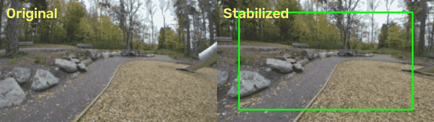
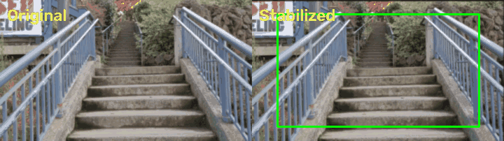
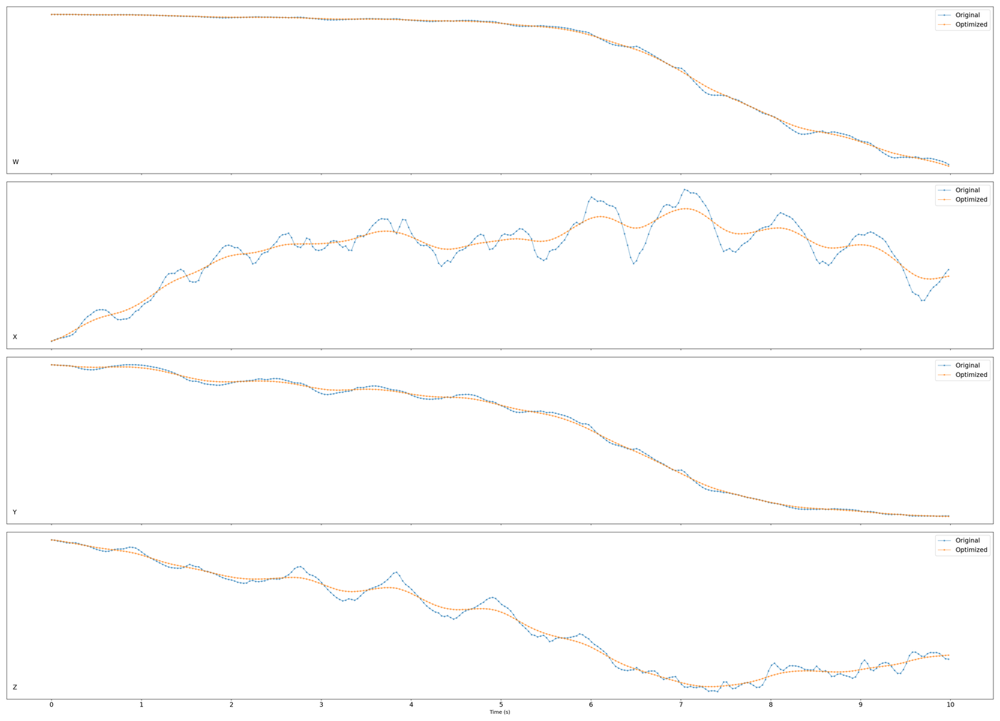
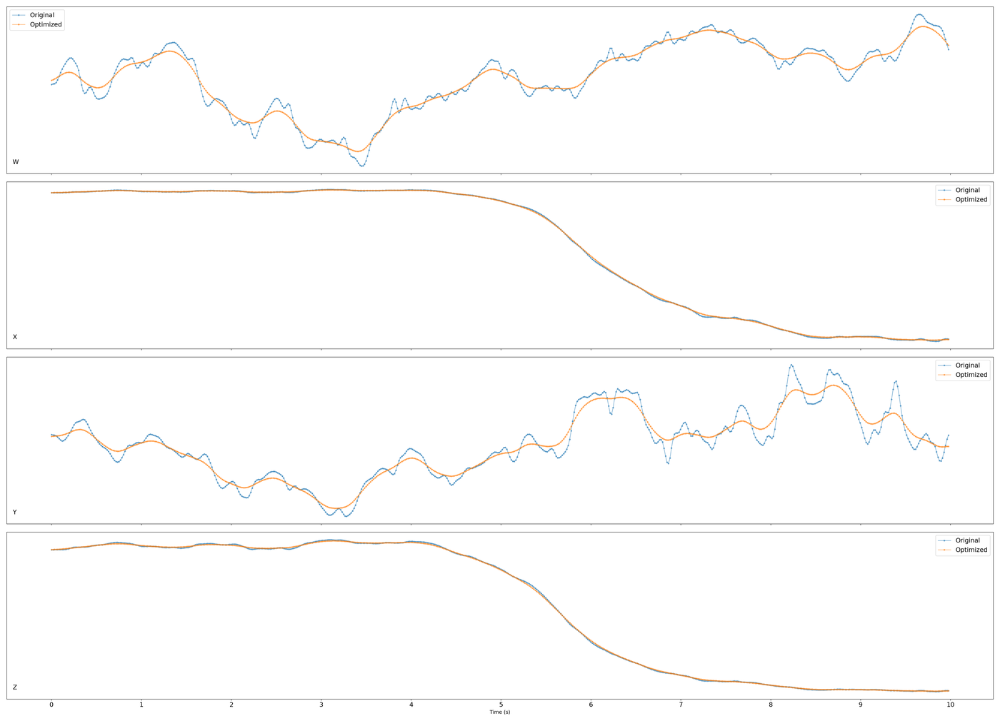

# Quartet

Turns IMU orientation into a smooth sequence that still keeps the stabilized frame inside its crop boundary. The boundary is not checked after smoothing; it is a hard constraint in the optimization itself, so orientation and crop margin converge in one pass. Across 59 sequences and 5806 windows the worst violation is **0.045 px** against a 0.05 px tolerance, `violations=0` throughout.

The solver is Gauss-Newton with an augmented Lagrangian: velocity, acceleration, jerk and fidelity losses inside, SDF constraints from an RCS grid outside; the derivation is in `docs/`. The repository includes input and render adapters for GoPro-IMU, ADVIO and DVS, plus tools for comparison plots and side-by-side GIFs.

[中文](README.md)

---

## Layout

```
quartet/
├── CMakeLists.txt          build script
├── AGENTS.md               repository conventions
├── src/                    C++ (main / DataLoader / Optimizer / GeometryTools / FileUtils)
├── include/                headers
├── data/                   default input and output
│   ├── quat.csv            input orientation
│   ├── opt.csv             result (overwritten each run)
│   ├── rcs.csv             RCS grid
│   └── conf.yaml           intrinsics, frame size, grid, crop
├── adapters/               dataset adapters (common.py is the shared math core)
│   ├── gopro_imu/
│   ├── advio/
│   └── dvs/
├── utils/
│   ├── plot_quaternions.py quaternion comparison plot
│   ├── make_compare_gif.py side-by-side GIF
│   ├── make_compare_still.py single-frame comparison
│   └── render_videos.py    batch render stabilized video
├── scripts/                batch optimize and render
├── tests/                  Jacobian, smoothness, SDF scale checks
└── docs/
    ├── media/              GIFs and plots used in the README
    └── *.md, *.pdf         derivations and references
```

---

## Build and run

Requires C++17, Eigen3, yaml-cpp, CMake ≥ 3.15. The Python side needs numpy, pandas, matplotlib, opencv-python, Pillow and h5py.

Run from the repository root:

```bash
mkdir -p build && cd build
cmake .. && make -j8

./quartet                # default paths
./quartet --verbose      # per-window diagnostics
```

| Flag | Default | Meaning |
|---|---|---|
| `--quat` | `../data/quat.csv` | input orientation |
| `--yaml` | `../data/conf.yaml` | config |
| `--rcs` | `../data/rcs.csv` | RCS grid |
| `--output` | `../data/opt.csv` | result |
| `--anchor-frames` | 3 | frames shared with the previous window |
| `--output-frames` | 15 | frames emitted per window |
| `--future-frames` | 30 | look-ahead frames |
| `--verbose` | off | per-window log |

---

## Data format

`quat.csv`: input orientation, time column in integer nanoseconds.

```csv
time,w,x,y,z
187429127482005,1,0.00029231,-0.000102913,-0.000139989
```

`opt.csv`: the result. Four columns, w,x,y,z, no header and no timestamps. Row index is the frame index and lines up with `quat.csv`, fixed at 8 decimals.

```csv
0.99999966,-0.00013632,-0.00079879,-0.00015320
```

`conf.yaml`: 10 keys.

```yaml
calFocalX: 685.7390663193302     # true K, pixel origin at top left
calFocalY: 685.7390663193302
calPrincipalX: 959.500000
calPrincipalY: 539.500000
frameWidth: 1920
frameHeight: 1080
gridCols: 11                     # GoPro 55×55, ADVIO / DVS 11×11
gridRows: 11
cropFactorH: 0.2                 # cropFactor / 2 per side
cropFactorV: 0.2
```

`rcs.csv`: one row per frame with `2 × gridCols × gridRows` normalized center coordinates, row-major (`j*cols + i`).

---

## Objective

Four weighted losses: three smoothness terms and one fidelity term:

| Term | Weight | Meaning |
|---|---|---|
| velocity | `lambda1 = 1.0` | relative rotation between adjacent frames |
| acceleration | `lambda2 = 2.0` | second-order difference |
| jerk | `lambda3 = 8.0` | third-order difference |
| fidelity | `mu = 0.02` | deviation from the input |

Outer augmented Lagrangian: penalty `rho` starts at 20, multiplies by `gamma = 2` on failure, capped at 500.

---

## Convention

Quaternions and rotation matrices use `p_current = R(q) · p_world` (world → camera) throughout; nothing in the chain conjugates.

---

## Dataset adapters

Same flow for all three: `to_input` writes `quat.csv`, `rcs.csv` and `conf.yaml`, the C++ binary produces `opt.csv`, `render` turns it into video.

**GoPro-IMU**: true K `fx=868.10, fy=881.58`, `readout=31.67 ms`, 29.97 fps, 55×55 grid.

```bash
python3 adapters/gopro_imu/gopro_imu_to_input.py <data_dir> <seq> <out_dir>
python3 adapters/gopro_imu/gopro_imu_render.py <seq_dir> <out_dir> --fix0
python3 adapters/gopro_imu/gopro_imu_render.py <seq_dir> <out_dir> --opt-quat <opt.csv> --out-name stab_dense.mp4
```

**ADVIO**: intrinsics routed from the official yaml per device batch, radtan distortion, `readout=0`, 60 fps portrait, 11×11 grid.

```bash
python3 adapters/advio/advio_to_input.py --seq advio-21 --pose arkit
python3 adapters/advio/advio_render.py --seq advio-21 --pose arkit --scan-axis col
```

**DVS**: `readout=15.98 ms`, fov 1.27, no LDC, OIS handled as translation, 207 Hz gyro, 11×11 grid.

```bash
python3 adapters/dvs/dvs_to_input.py --seq s_115c_outdoor_running_Upstairs_daytime
python3 adapters/dvs/dvs_render.py --seq s_115c_outdoor_running_Upstairs_daytime --f0 0 --f1 417
```

The render mode has no default: pass `--fix0` (anchor the first frame, to check the pipeline) or `--opt-quat` (final output).

---

## Results

One representative sequence per dataset. In each clip the original is on the left and the stabilized result on the right; the green box is the crop boundary. Plots show the four quaternion components. Click any figure for full size.

Clips are grouped by orientation: two landscape ones stacked on the left (GoPro, DVS), one portrait on the right (ADVIO), with matching total height.

<table align="center">
  <tr>
    <td align="center">
      <a href="docs/media/gopro/playground1.gif"></a><br>
      <sub>GoPro-IMU · playground1</sub><br>
      <a href="docs/media/dvs/s_115c_Upstairs_daytime.gif"></a><br>
      <sub>DVS · s_115c Upstairs</sub>
    </td>
    <td align="center" valign="middle">
      <a href="docs/media/advio/advio-21.gif"></a><br>
      <sub>ADVIO · advio-21 (portrait)</sub>
    </td>
  </tr>
</table>

<table align="center">
  <tr>
    <td align="center"><a href="docs/media/gopro/playground1.png"></a><br><sub>GoPro-IMU · playground1</sub></td>
    <td align="center"><a href="docs/media/advio/advio-21.png"></a><br><sub>ADVIO · advio-21 (30–40 s)</sub></td>
    <td align="center"><a href="docs/media/dvs/s_115c_Upstairs_daytime.png"></a><br><sub>DVS · s_115c Upstairs</sub></td>
  </tr>
</table>

---

## Plots

```bash
# four-component quaternion comparison, x axis in seconds
python3 utils/plot_quaternions.py --original <quat.csv> --optimized <opt.csv> \
    --out-dir <dir> --clip-sec 10 --start-sec 0

# side-by-side GIF, aspect follows the source
python3 utils/make_compare_gif.py --ori <original> --stab <stabilized> --out out.gif \
    --dur-sec 10 --start-sec 0 --fps 10 --width 480 --colors 96
```

`--clip-sec 0` means the whole clip; `--start-sec` defaults to the center.

---

## Dataset download

Original data, pipeline input, optimizer output and stabilized video for 14 sequences: [Google Drive](https://drive.google.com/drive/folders/1z-KH7VKPUNK6Lcg4NO7veKsK46Q-ur_A)

---

## Sources and licenses

| Dataset | Download | Source | License |
|---|---|---|---|
| GoPro-IMU | [LiU CVL](https://www.cvl.isy.liu.se/research/datasets/gopro-imu-dataset/) (`gopro-imu-dataset.zip`) | Ovrén, Forssén, *Spline Error Weighting for Robust Visual-Inertial Fusion*, CVPR 2018 | CC BY-SA 4.0 |
| ADVIO | [AaltoVision/ADVIO](https://github.com/AaltoVision/ADVIO) | Cortés, Solin, Rahtu, Kannala, *ADVIO: An Authentic Dataset for Visual-Inertial Odometry*, ECCV 2018 | see the repository license |
| DeepFVS | [zhmeishi.github.io/dvs](https://zhmeishi.github.io/dvs/) | Shi et al., *Deep Online Fused Video Stabilization*, WACV 2022 | CC BY-NC 4.0, non-commercial |

This repository uses the data for stabilization evaluation only and does not modify the original content. The GIFs and plots under `docs/media/` are rendered from these sequences.

---

## Docs

| Document | Contents |
|---|---|
| `docs/quaternion-optimization.md` | problem formulation and derivation |
| `docs/left-increment-loss1-gradient.md` | left increment and the velocity-term gradient |
| `docs/coarse-sdf-screening.md` | coarse SDF pruning |
| `docs/a-micro-lie-theory-for-state-estimation-in-robotics.pdf` | Lie group reference |
| `AGENTS.md` | repository conventions |
