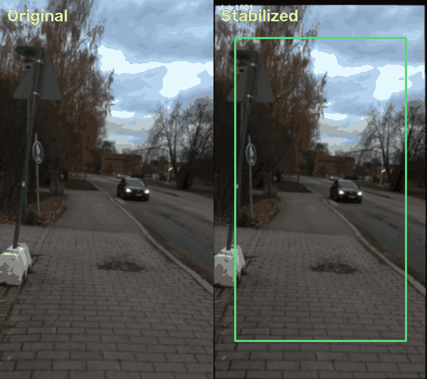
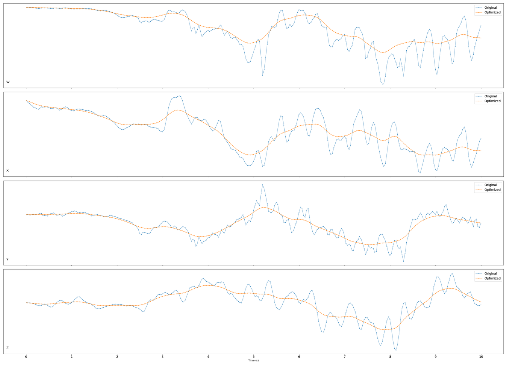

# Quartet

Turns IMU orientation into a smooth sequence that still keeps the stabilized frame inside its crop boundary.

The boundary is part of the optimization, not a check afterwards: orientation and margin converge together, so the solution lands in the feasible set. Across 59 sequences and 5806 windows the worst violation is 0.045 px. Compared with "smooth first, then crop away the overflow", the crop here is fixed in advance and does not depend on how the smoothing turned out.

The solver is Gauss-Newton with an augmented Lagrangian: the inner loop minimizes velocity, acceleration, jerk and fidelity losses, the outer loop enforces SDF constraints from an RCS grid. The derivation is in `docs/`.

Includes input and render adapters for GoPro-IMU, ADVIO and DVS, plus tools for comparison plots and side-by-side GIFs.

[中文](README.md)

---

## Layout

```
quartet/
├── src/                    C++ (main / DataLoader / Optimizer / GeometryTools / FileUtils)
├── include/                headers
├── data/                   default input and output
│   ├── quat.csv            input orientation
│   ├── opt.csv             result (overwritten each run)
│   ├── rcs.csv             RCS grid
│   └── conf.yaml           intrinsics, frame size, grid, crop
├── adapters/               dataset adapters (common.py is the shared math core)
│   ├── gopro_imu/
│   ├── advio/
│   └── dvs/
├── utils/
│   ├── plot_quaternions.py quaternion comparison plot
│   └── make_compare_gif.py side-by-side GIF
├── scripts/                batch optimize and render
├── tests/                  Jacobian, smoothness, SDF scale checks
└── docs/
    ├── media/              GIFs and plots used in the README
    └── *.md, *.pdf         derivations and references
```

---

## Build and run

Requires C++17, Eigen3, yaml-cpp, CMake ≥ 3.15. The Python side needs numpy, pandas, matplotlib, opencv-python, Pillow and h5py.

Run from the repository root:

```bash
mkdir -p build && cd build
cmake .. && make -j8

./quartet                # default paths
./quartet --verbose      # per-window diagnostics
```

| Flag | Default | Meaning |
|---|---|---|
| `--quat` | `../data/quat.csv` | input orientation |
| `--yaml` | `../data/conf.yaml` | config |
| `--rcs` | `../data/rcs.csv` | RCS grid |
| `--output` | `../data/opt.csv` | result |
| `--anchor-frames` | 3 | frames shared with the previous window |
| `--output-frames` | 15 | frames emitted per window |
| `--future-frames` | 30 | look-ahead frames |
| `--verbose` | off | per-window log |

---

## Data format

`quat.csv`: input orientation, time column in integer nanoseconds.

```csv
time,w,x,y,z
187429127482005,1,0.00029231,-0.000102913,-0.000139989
```

`opt.csv`: the result. Four columns, w,x,y,z, no header and no timestamps. Row index is the frame index and lines up with `quat.csv`, fixed at 8 decimals.

```csv
0.99999966,-0.00013632,-0.00079879,-0.00015320
```

`conf.yaml`: 10 keys.

```yaml
calFocalX: 685.7390663193302     # true K, pixel origin at top left
calFocalY: 685.7390663193302
calPrincipalX: 959.500000
calPrincipalY: 539.500000
frameWidth: 1920
frameHeight: 1080
gridCols: 11                     # GoPro 55×55, ADVIO / DVS 11×11
gridRows: 11
cropFactorH: 0.2                 # cropFactor / 2 per side
cropFactorV: 0.2
```

`rcs.csv`: one row per frame with `2 × gridCols × gridRows` normalized center coordinates, row-major (`j*cols + i`).

---

## Convention

Quaternions and rotation matrices use `p_current = R(q) · p_world` (world → camera) throughout; nothing in the chain conjugates.

---

## Dataset adapters

Same flow for all three: `to_input` writes `quat.csv`, `rcs.csv` and `conf.yaml`, the C++ binary produces `opt.csv`, `render` turns it into video.

**GoPro-IMU**: true K `fx=868.10, fy=881.58`, `readout=31.67 ms`, 29.97 fps, 55×55 grid.

```bash
python3 adapters/gopro_imu/gopro_imu_to_input.py <data_dir> <seq> <out_dir>
python3 adapters/gopro_imu/gopro_imu_render.py <seq_dir> <out_dir> --fix0
python3 adapters/gopro_imu/gopro_imu_render.py <seq_dir> <out_dir> --opt-quat <opt.csv> --out-name stab_dense.mp4
```

**ADVIO**: intrinsics routed from the official yaml per device batch, radtan distortion, `readout=0`, 60 fps portrait, 11×11 grid.

```bash
python3 adapters/advio/advio_to_input.py --seq advio-21 --pose arkit
python3 adapters/advio/advio_render.py --seq advio-21 --pose arkit --scan-axis col
```

**DVS**: `readout=15.98 ms`, fov 1.27, no LDC, OIS handled as translation, 207 Hz gyro, 11×11 grid.

```bash
python3 adapters/dvs/dvs_to_input.py --seq s_115c_outdoor_running_Upstairs_daytime
python3 adapters/dvs/dvs_render.py --seq s_115c_outdoor_running_Upstairs_daytime --f0 0 --f1 417
```

The render mode has no default: pass `--fix0` (anchor the first frame, to check the pipeline) or `--opt-quat` (final output).

---

## Results

One representative sequence per dataset. Original on the left, stabilized on the right; the green box is the crop boundary. Click a figure for full size.

**GoPro-IMU · playground1**

<p align="center">
  <a href="docs/media/gopro/playground1.gif"></a>
  <br>
  <a href="docs/media/gopro/playground1.png"></a>
</p>

**ADVIO · advio-21** (portrait, seconds 30–40)

<p align="center">
  <a href="docs/media/advio/advio-21.gif"></a>
  <br>
  <a href="docs/media/advio/advio-21.png"></a>
</p>

**DVS · s_115c_Upstairs_daytime**

<p align="center">
  <a href="docs/media/dvs/s_115c_Upstairs_daytime.gif"></a>
  <br>
  <a href="docs/media/dvs/s_115c_Upstairs_daytime.png"></a>
</p>

The `[Verify]` line in `opt.log` records `max_sdf`, the largest signed distance from the four crop corners to the boundary, positive meaning outside. Over 59 sequences and 5806 windows the worst case is 0.045 px with `violations=0` against a 0.05 px tolerance. Sequences with tight margins, mostly DVS and ADVIO, converge right up to the tolerance — the constraint is doing work rather than coasting on slack.

---

## Plots

```bash
# four-component quaternion comparison, x axis in seconds
python3 utils/plot_quaternions.py --original <quat.csv> --optimized <opt.csv> \
    --out-dir <dir> --clip-sec 10 --start-sec 0

# side-by-side GIF, aspect follows the source
python3 utils/make_compare_gif.py --ori <original> --stab <stabilized> --out out.gif \
    --dur-sec 10 --start-sec 0 --fps 10 --width 480 --colors 96
```

`--clip-sec 0` means the whole clip; `--start-sec` defaults to the center.

---

## Dataset download

Original data, pipeline input, optimizer output and stabilized video for 14 sequences: [Google Drive](https://drive.google.com/drive/folders/1z-KH7VKPUNK6Lcg4NO7veKsK46Q-ur_A)

---

## Docs

| Document | Contents |
|---|---|
| `docs/quaternion-optimization.md` | problem formulation and derivation |
| `docs/left-increment-loss1-gradient.md` | left increment and the velocity-term gradient |
| `docs/coarse-sdf-screening.md` | coarse SDF pruning |
| `docs/a-micro-lie-theory-for-state-estimation-in-robotics.pdf` | Lie group reference |
| `AGENTS.md` | repository conventions |
